# Patient list: flows

Status: draft for the maintainer's review (2026-10-18)

Each flow traces to the brief and requirements (S#, C#, D#). **Question** marks something the
brief doesn't answer yet. Teammates' actions in the prototype are simulated (decision 0018).

## The patient's lifecycle on the list

How a patient moves through the list from referral to archival. An expected patient moves through
the same states, and is linked to a URN and an encounter whenever they're registered (F1a).

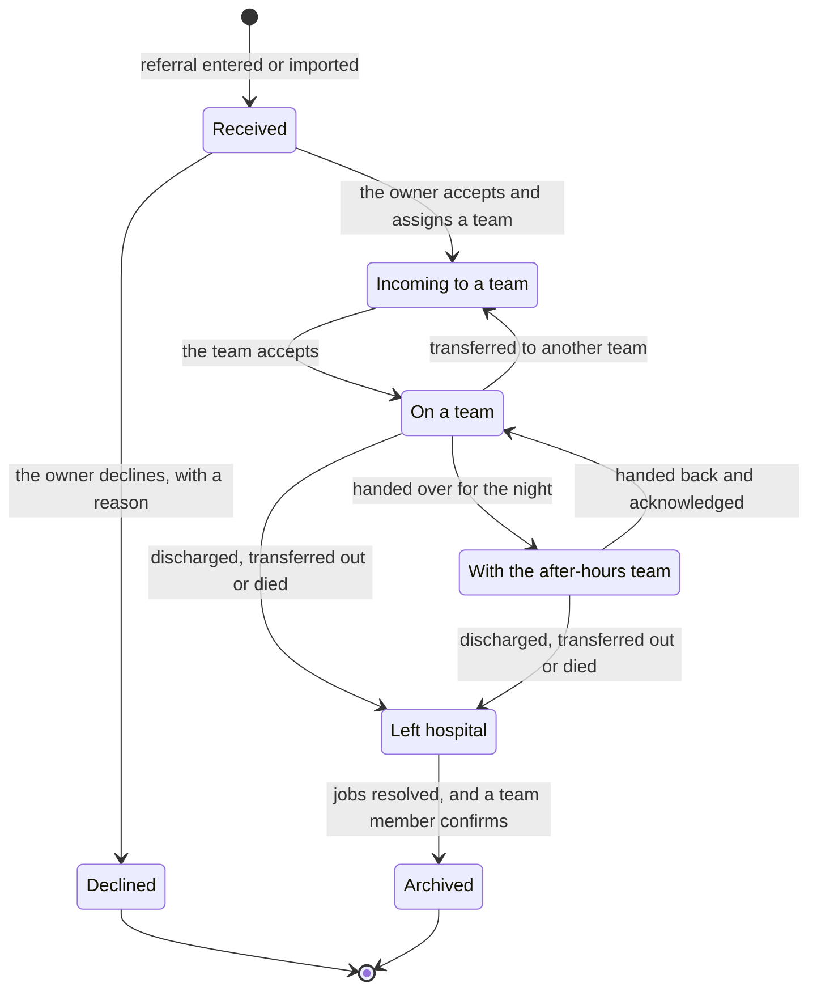

## Happy paths

### F1. A referral arrives

1. A referral arrives in one of two ways: the admitting registrar takes a call from ED or another
   source and enters it by hand, or it comes from a separate referral system with its basic details
   filled in. An imported referral says which system it came from.
2. The admitting registrar opens the unit's admitting list (on a phone, a drawer; on a desktop, a
   sheet) and finds the patient by name or URN. Each result shows first and last name, age, gender
   and URN, and similar patients are indicated (S10).
3. If the patient isn't registered yet, they're added as **expected**: a placeholder on the list,
   clearly marked, that "needs a UR + encounter attached" (F1a).
4. They record the source, referring clinician, urgency, reason, clinical summary and initial plan,
   and save. The referral appears on the admitting list as received, live for everyone on the list
   (C1).
5. **Every referral has an owner**, who accepts it and assigns it to a team, or declines it with a
   reason: "Someone needs to own and close/decline that referral". It can't be left without one.
   A consultant, a clinical nurse or, rarely, the admitting registrar assigns it.
6. The patient appears on the team's list as incoming. The team accepts, and the patient joins their
   list. Until then the patient stays on the admitting list, so they are never without a team (S13).

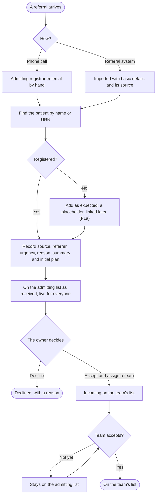

### F1a. Linking an expected patient

1. An expected patient's row says they are expected and not yet linked, in place of a URN, so no one
   mistakes the placeholder for a registered patient.
2. When the patient is registered, someone links the placeholder to their URN and encounter: they
   search, check the identifiers against the placeholder (S10), and confirm.
3. The row then shows the patient's identifiers and record data, and the history records who linked
   them and when.
   **Question:** what does a placeholder hold before it's linked (a name, an approximate age, where
   the patient is now), and who may link it?

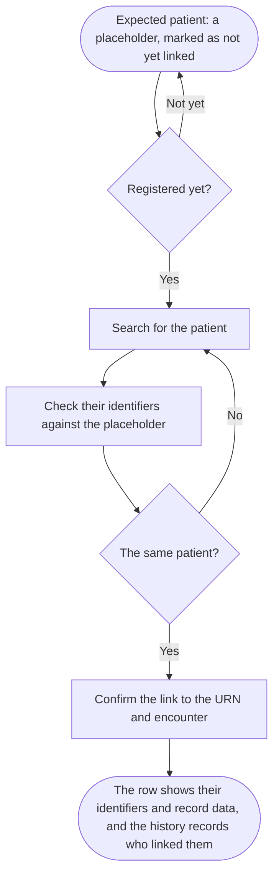

### F2. A patient moves to another team or unit

1. Whoever assigns the patient chooses the new team and writes a brief handover note. The clinical
   summary from the referral carries over with it.
2. The receiving team sees the patient as incoming, with the note and the summary, and accepts.
   Acceptance closes the loop: the patient leaves the old team's list and joins the new one.
3. The patient's history records the move, the note, who sent it, who accepted it and when (A14).

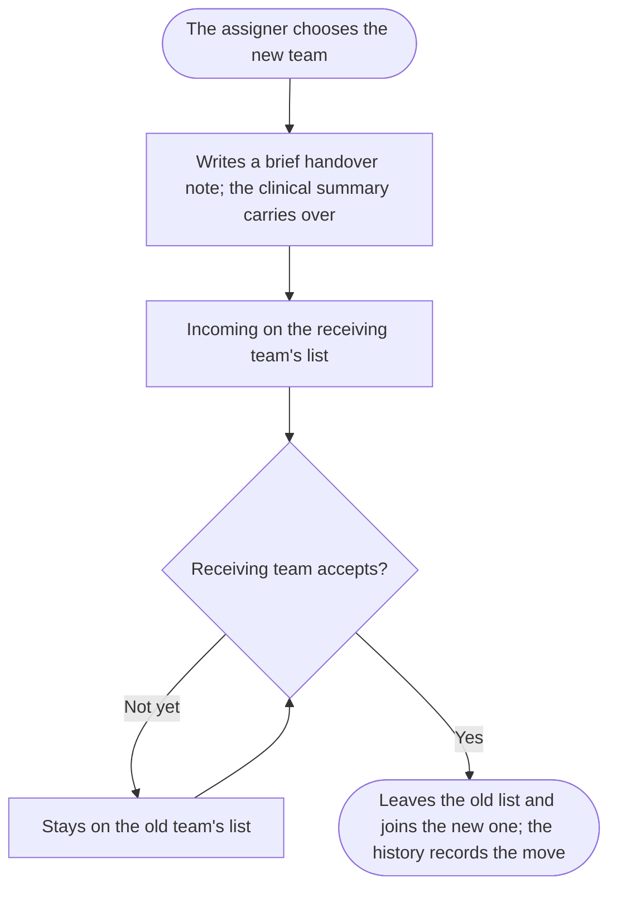

### F3. The ward round

1. The team opens its list, on a bedside workstation or a phone. Rows are in bed order, and each
   shows bed, name, age, gender, URN, working problem, days since admission, flags, acuity,
   outstanding jobs and whether the patient has been seen.
2. Presence shows who else on the team has the list open (C2).
3. They open a patient. Beside the list (on a phone, in place of it) are the referral summary,
   problems, recent observations and results as the record gives them, jobs, comments, flags and
   acuity.
4. The scribe adds jobs, assigning each to a person or the team with an optional due time, adds
   comments, and updates acuity and flags. Each change is live for the team (C1).
5. They mark the patient complete and move to the next. The round is done when every patient is
   marked; any left unmarked stay visible as such.

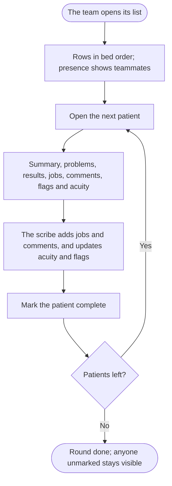

### F4. Jobs through the day

1. A doctor narrows the jobs on a list to their own with a filter, a segmented control or a
   combobox, rather than a separate view, and sees the patient each job belongs to.
2. A nurse sees the jobs within their scope and completes them; the others are visible but can't
   be completed by them (S11).
3. A completed job updates live for everyone (C1), with who completed it and when.

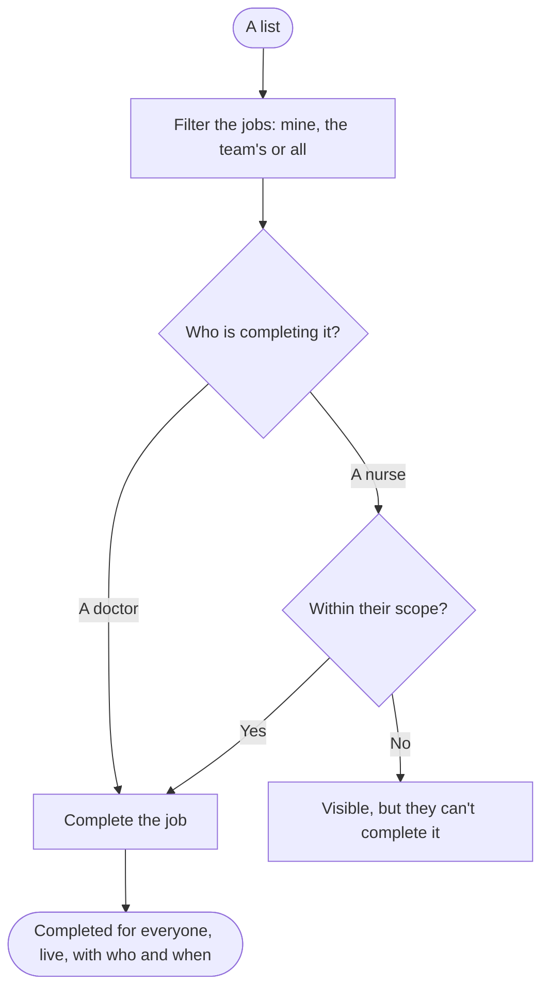

### F5. Handing over to the after-hours team

1. Before the end of the day, each team marks the patients who need attention overnight, by a
   priority level or a flag chosen for that purpose, and adds things to do overnight, each with a
   reason. The day team's synopsis and progress go with each patient.
2. The team hands over. The after-hours team inherits ownership of every patient in the unit.
3. The after-hours registrar opens one list of the whole unit. Patients marked important come
   first, grouped by team. Stable patients with nothing marked are collapsed, with a count, and
   expand with the keyboard (D4).
4. They accept each team's handover, then work through the important patients. They can add,
   complete and adjust jobs, flags and acuity as necessary.
5. A collapsed patient who deteriorates, or is marked important, becomes active and visible (S12).
   The reason is shown with its source: a clinician, a source system's deterioration signal, or an
   AI model, which is labelled as AI (S2, S3).

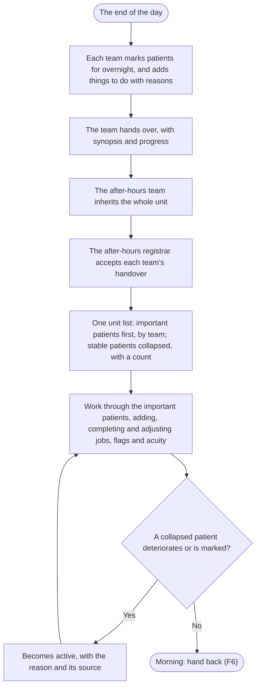

### F6. Handing back in the morning

1. The after-hours team adds an overnight summary to each patient they saw, and the jobs they did
   or created.
2. They hand back. Each patient returns to their day team's list.
3. The day team acknowledges the hand-back: these are their patients, so they can't refuse it.
   Whether a handover is accepted or acknowledged is a setting (C6).
4. Overnight changes stay highlighted on each patient until someone on the team has read them.

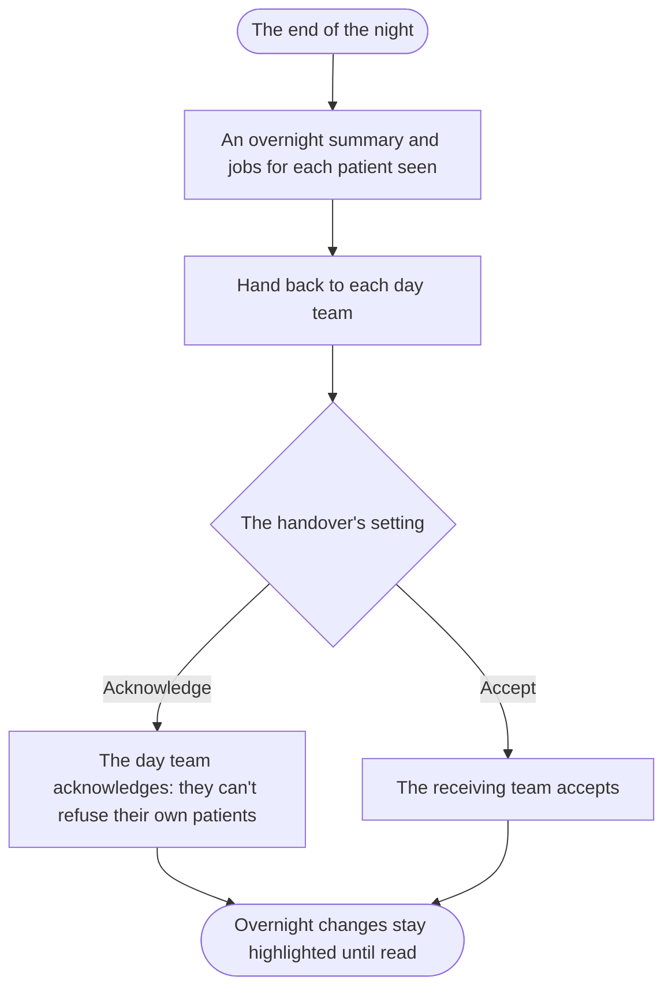

### F7. Building an audit list

1. A doctor, or the head of unit, starts an audit list and chooses its criteria from demographics,
   conditions, the latest observations and labs within a time window, medicines, and the list's
   own fields such as flags, acuity and team. They enter every value; nothing is pre-filled (S4).
2. A preview shows how many patients match, and who.
3. They name the list, save it, and share it view-only or with editing.
4. The list stays up to date. A patient who comes to meet the criteria appears, marked as new
   (C3). The criteria are always shown with the list (S4).
5. Anyone who can edit the list can remove a patient who no longer fits. The removal applies to
   this list only, and shows who removed them and when (S5).

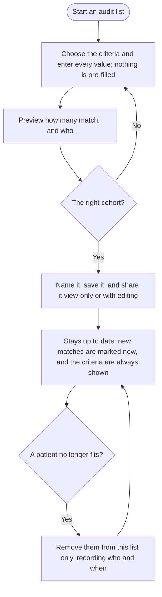

### F8. A personal list

1. A doctor adds patients from any list to a private list of their own, for example to track their
   procedures.
2. The patients stay on their teams' lists as before. The personal list is the doctor's view only.

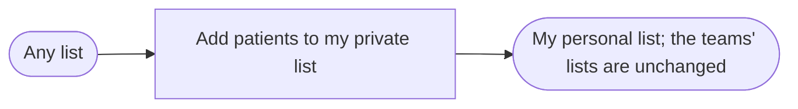

### F9. Leaving hospital and archival

1. When a patient leaves hospital (discharged, transferred out or died), their row says so and how,
   as the record gives it.
2. The list asks the team to complete, reassign or close each outstanding job, with a reason when
   closed.
3. Once no job is open, the list suggests archiving the patient (S14).
4. A team member confirms. The patient leaves every list, and their history is kept.

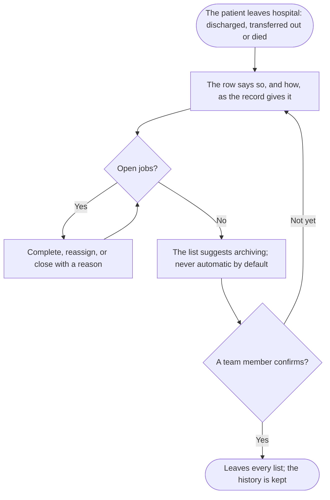

## Interruptions

- **A page or call in the middle of the round.** The list keeps the patient and the draft the scribe
  was on, and returns to them.
- **A teammate edits the same job or field.** The second person sees the conflict and chooses which
  to keep (C4).
- **A new referral or a change arrives while someone is reading.** It's announced and shown when
  they choose; no row moves under their pointer or finger (C3, D3).
- **The phone loses its connection, for example in a lift.** Changes are kept and marked as not yet
  shared, and the list says how old its data is (C5).
- **A patient deteriorates during the round.** Their row shows the signal with its source, and the
  team can act on it without leaving the list (S2).

## States

| State    | What the person sees                                                                                                    | What they can do                                   |
| -------- | ----------------------------------------------------------------------------------------------------------------------- | -------------------------------------------------- |
| Empty    | The list has no patients, and says what fills it: a referral for the admitting list, criteria for an audit list.        | Add a referral, change the criteria, add a patient |
| Loading  | The rows' shape, without content, so the layout doesn't jump.                                                           | Wait                                               |
| Partial  | What loaded, with what didn't named in place, such as "results not available". Never blank, and never zero for missing. | Retry the part that failed                         |
| Error    | A change that couldn't be saved, kept and marked as unsaved, with the reason.                                           | Retry, or discard the change                       |
| Offline  | That the list is offline, which changes aren't shared yet, and how old the data is.                                     | Keep working; changes send on reconnection         |
| Stale    | How long ago the data was updated, wherever it might be out of date.                                                    | Refresh                                            |
| Conflict | Both versions of an edit, and who made each.                                                                            | Keep one, or combine them                          |

## Open questions

- What does an expected patient's placeholder hold before it's linked, and who may link it? (F1a)
