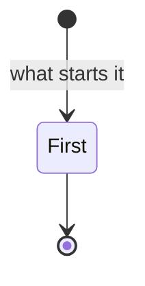
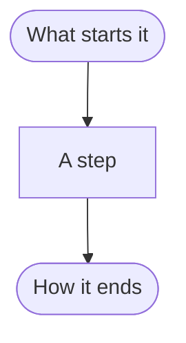

# <Feature>: flows

## Lifecycle

Only when the feature moves things through states.

## Happy path

### F1. <Flow>

1. Steps, each traced to the requirements.

## Interruptions

## States

| State    | What the person sees | What they can do |
| -------- | -------------------- | ---------------- |
| Empty    |                      |                  |
| Loading  |                      |                  |
| Partial  |                      |                  |
| Error    |                      |                  |
| Offline  |                      |                  |
| Stale    |                      |                  |
| Conflict |                      |                  |
